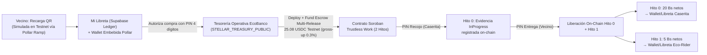

# 🌱 EcoBanco Bolivia — Recuperando nuestro valor en comunidad

**EcoBanco Bolivia** es un marketplace barrial **B2B2C** con **Pago Protegido** (escrow programable sobre Stellar/Soroban Testnet) y **Eco-Delivery** en bicicleta o moto eléctrica para caseritas de mercados populares y vecinos de **El Alto y Achocalla, Bolivia**.

* **Sitio público (MVP en Stellar Testnet):** [https://www.ecobanco.lat](https://www.ecobanco.lat)
* **Evidencia comunitaria y testimonios reales (757 seguidores):** [TikTok @eco.banco.bolivia](https://www.tiktok.com/@eco.banco.bolivia)
* **Modelo de negocio en una línea:** Plan Base **0 Bs/mes y 0% comisión por venta** para caseritas y vecinos + suscripción opcional **Caserita Aliada / Prosumidor de 100 Bs/mes** (pagable en Bs o MOTES de ventas, incluye QR propio, 5 envíos ecológicos de 5 Bs y visibilidad barrial) + tarifa comunitaria de **5 Bs** al Eco-Rider.

> [!NOTE]
> **Alcance transparente del MVP actual (Fase 0 · Testnet):**
> * **Tracción actual:** **1 caserita real activa** (*Doña Eliana*, Mercado Villa Exaltación, El Alto) y **2 caseritas adicionales en onboarding** del piloto.
> * **Recarga QR en Testnet:** La recarga QR vía Pollar Ramp opera en **modo simulado/prueba sobre Stellar Testnet** (no debita cuentas bancarias bolivianas reales en esta fase).
> * **Bot de WhatsApp:** Planificado para **Fase 1 (próximamente)**; hoy la coordinación por WhatsApp funciona mediante enlaces directos `wa.me` desde la app web.

---

## 🎯 Problema Principal, Mercado y Fuentes Verificadas

### 1. Dolor principal único
**Las caseritas de barrio quedan excluidas del comercio digital y del delivery formal** porque las plataformas tradicionales cobran comisiones del **20% al 30% por pedido** cuando incluyen logística integral (tras promociones iniciales del 10%), un costo inviable frente a márgenes netos gastronómicos del **10% al 20%** (*fuentes: reportes del sector gastronómico en [El Deber](https://eldeber.com.bo) y [Los Tiempos](https://www.lostiempos.com), y condiciones comerciales de delivery marketplace en Bolivia*). Como consecuencia directa, el comercio barrial sigue atrapado en ventas sin respaldo digital, desconfianza del vecino al pagar por adelantado y apps pesadas que consumen sus megas en 3G.

### 2. Tamaño de mercado numérico (El Alto y Achocalla)
En lugar de citar solo porcentajes de informalidad, dimensionamos el mercado alcanzable con cifras oficiales:

| Nivel | Definición | Número concreto | Fuente |
| :--- | :--- | :--- | :--- |
| **Población foco** | Habitantes en el corredor urbano El Alto (`885,035`) + Achocalla (`46,068`) | **931,103 habitantes** | INE Bolivia — Censo de Población y Vivienda 2024 |
| **TAM** | Comerciantes gremiales catastrados en El Alto (300–335 asociaciones; >25,000 solo en Feria 16 de Julio) | **70,000+ puestos / caseritas** | Dirección de Ferias y Mercados — GAMEA El Alto |
| **SAM** | Puestos de comida preparada, panadería, abarrotes y productos barriales con smartphone + WhatsApp en zonas urbanas objetivo | **~12,000 caseritas** | Estimación operativa sobre rubros de consumo diario (17% del TAM) |
| **SOM (12 meses)** | Meta piloto Fase 1–2 en 3 zonas foco (Villa Exaltación, Ciudad Satélite y Achocalla) | **150 caseritas activas** (`3,000 pedidos/mes` · `75,000 Bs/mes GMV`) | Meta operativa (`20 pedidos/mes × 25 Bs` ticket promedio) |

---

## 📊 Tracción Real y Evidencia Comunitaria

| Indicador | Estado real verificable hoy | Evidencia |
| :--- | :--- | :--- |
| **Caseritas piloto** | **1 caserita real activa** (*Doña Eliana*, Mercado Villa Exaltación, Puesto 28 — producto real: *Sopita de Fideo* a 8 Bs, venta previa solo presencial/WhatsApp sin delivery formal) + **2 caseritas en onboarding** | Catálogo activo en [www.ecobanco.lat/marketplace](https://www.ecobanco.lat/marketplace) |
| **Comunidad y ferias** | Comunidad construida desde ferias presenciales en El Alto y Achocalla + **757 seguidores orgánicos** con videos y testimonios reales de participantes hablando en cámara | [tiktok.com/@eco.banco.bolivia](https://www.tiktok.com/@eco.banco.bolivia) |
| **Flota ecológica disponible** | **3 bicicletas** y **1 moto eléctrica** listas para operación piloto local | Flota comunitaria del equipo y repartidores locales |
| **Pedidos completados on-chain (Testnet)** | **1 pedido piloto real liquidado** con Doña Eliana (`32 Bs`, 4 platos) + **1 pedido E2E demo verificado** (`20 Bs` + `5 Bs` envío) con 9 transacciones auditables | Ver sección [Prueba verificable en Stellar Testnet](#-prueba-verificable-en-stellar-testnet) |

---

## 💸 Modelo de Negocio Unificado (B2B2C) y Unit Economics

* **Tipo de cliente:** **B2B2C** (microcomercios/caseritas como oferta y clientes de la suscripción opcional; vecinos como compradores).
* **Modelo de ingresos:** **Freemium + Suscripción opcional** (sin comisión por transacción ni `fee per transaction`):
  * **Plan Base — `0 Bs/mes` y `0% comisión`:** Publicar catálogo con Modo Megas, vender con Pago Protegido y recibir el 100% del precio.
  * **Suscripción opcional "Caserita Aliada / Prosumidor" — `100 Bs/mes`** (implementada en `/panel-caserita` y `/perfil-usuario`; pagable en **Bs o con 100 MOTES** de ventas propias): incluye habilitación de cobro por QR propio verificado, **5 envíos ecológicos incluidos (valor de 25 Bs)** y visibilidad destacada en el barrio.

### Economía de un pedido típico de `20 Bs`

| Concepto | Monto (Bs) | Quién paga / recibe | Detalle |
| :--- | :---: | :--- | :--- |
| **Producto local** (ej. comida / abarrotes) | `20.00 Bs` | Paga Vecino → Recibe **Caserita (`100%`)** | **0 Bs de comisión** para EcoBanco |
| **Envío ecológico Eco-Rider** | `5.00 Bs` | Paga Vecino (estándar) → Recibe **Eco-Rider (`100%`)** | Flota bici / moto eléctrica |
| **Total pagado por el Vecino** | **`25.00 Bs`** | — | Transparente y sin sobrecargos |
| **Fee de Escrow Soroban (`0.3%` Trustless Work)** | `~0.08 Bs` | **Absorbido por EcoBanco** | Gross-up automático (`monto / 0.997` → `25.08 USDC` en Testnet) |
| **Envíos gratis promocionales (bienvenida / referidos)** | `5.00 Bs` / envío | **Fondo de Adquisición EcoBanco** | Topado a 1–2 envíos por vecino referido (`CAC 5–10 Bs`) o cubierto dentro de los 5 envíos (`25 Bs`) de la cuota mensual de `100 Bs` + reserva comunitaria de ferias (no es ilimitado). |

---

## ⛓️ Prueba Verificable en Stellar Testnet (Soroban + Trustless Work)

Cada pedido despliega y liquida un contrato **Escrow Multi-Release real en Soroban Testnet** vía `@trustless-work/escrow` (`dev.api.trustlesswork.com`) y `@stellar/stellar-sdk` (`https://horizon-testnet.stellar.org`).

### Cuentas clave en Stellar Testnet
* **Tesorería Operativa (`STELLAR_TREASURY_PUBLIC`):** [`GDFA45QTAFEVHYHUVSXJAJFMTJ53PUEMHCKEFBPXIGOYOHTDCY52DNO7`](https://stellar.expert/explorer/testnet/account/GDFA45QTAFEVHYHUVSXJAJFMTJ53PUEMHCKEFBPXIGOYOHTDCY52DNO7)
* **Dirección de Plataforma configurada (`TRUSTLESS_WORK_PLATFORM_ADDRESS`):** [`GCLCCT5Y3Y5P7YEH3IWJUTA4ZOBCM323HC6JTOWPMI5FDU7OHHJHCHRA`](https://stellar.expert/explorer/testnet/account/GCLCCT5Y3Y5P7YEH3IWJUTA4ZOBCM323HC6JTOWPMI5FDU7OHHJHCHRA) *(cuando aún no tiene trustline USDC activo en Testnet, `resolveOperationalStellarAddress()` hace fallback automático a la Tesorería Operativa)*.
* **Asset de liquidación en Testnet:** `USDC` ([`GBBD47IF6LWK7P7MDEVSCWR7DPUWV3NY3DTQEVFL4NAT4AQH3ZLLFLA5`](https://stellar.expert/explorer/testnet/asset/USDC-GBBD47IF6LWK7P7MDEVSCWR7DPUWV3NY3DTQEVFL4NAT4AQH3ZLLFLA5))

### Pedido Completo End-to-End Verificado (`20 Bs` Producto + `5 Bs` Envío → `25.08 USDC` con gross-up)
* **Contract ID (Escrow Multi-Release):** [`CAGGC7WSVXWJNOG2NK6IZER3O4HXBNG7HDDA5Z6DBF2EHK5TXVWZFFGH`](https://stellar.expert/explorer/testnet/contract/CAGGC7WSVXWJNOG2NK6IZER3O4HXBNG7HDDA5Z6DBF2EHK5TXVWZFFGH)
* **Trustless Work Viewer:** [Ver contrato en viewer.trustlesswork.com](https://viewer.trustlesswork.com/CAGGC7WSVXWJNOG2NK6IZER3O4HXBNG7HDDA5Z6DBF2EHK5TXVWZFFGH)

| Paso del ciclo de vida | Ledger | Transacción verificada en Stellar Expert (Testnet) |
| :--- | :---: | :--- |
| **1. Creación del Escrow Multi-Release (Deploy)** | `#5865610` | [`98505118...bc9ad673`](https://stellar.expert/explorer/testnet/tx/98505118e625f773e148d9b3485cd2abc6079206f703eb32ef155efbbc9ad673) |
| **2. Fondeo desde Tesorería (`25.08 USDC`)** | `#5865612` | [`8b96c879...5c9b48e5`](https://stellar.expert/explorer/testnet/tx/8b96c8794e2a813db5a5d7f868b430792e0704bb2bb307b5bf8558785c9b48e5) |
| **3. Evidencia Hito `"0"` — Recojo confirmado (PIN Caserita)** | `#5865613` | [`1e857214...af0af36`](https://stellar.expert/explorer/testnet/tx/1e857214f6c28e0ea94178cce402d3ef07a782a3b386719c00abeadd9af0af36) |
| **4a. Hito `"0"` Completado (Entrega PIN Vecino)** | `#5865614` | [`0bd6223e...ee75d9b8`](https://stellar.expert/explorer/testnet/tx/0bd6223e6dc6753d18215f2e7ba21dc49c4f50611c7ed89d37ec8913ee75d9b8) |
| **4b. Hito `"0"` Aprobado** | `#5865615` | [`c78b0979...c113c444`](https://stellar.expert/explorer/testnet/tx/c78b097938cfe8a322cc7de672bbbf77f50d0c06a5c8a4b9b1175031c113c444) |
| **4c. Hito `"0"` Liberado (`20 Bs` netos Caserita)** | `#5865616` | [`a0e8d452...6f556875`](https://stellar.expert/explorer/testnet/tx/a0e8d45270ab0fdf17ccec0031a20b1c1d7a7adf03067c43bb2b6cf66f556875) |
| **5a. Hito `"1"` Completado (Envío Eco-Rider)** | `#5865617` | [`7a0686c9...77f654a`](https://stellar.expert/explorer/testnet/tx/7a0686c98a4b9f3f1c690cb7b50d9b30005ef8815b83ea779c597597d77f654a) |
| **5b. Hito `"1"` Aprobado** | `#5865618` | [`307a0913...a347b56a`](https://stellar.expert/explorer/testnet/tx/307a0913b8a0f5577e29e322d8cee5ee3441a5712d88bfa61d00ea88a347b56a) |
| **5c. Hito `"1"` Liberado (`5 Bs` netos Eco-Rider)** | `#5865619` | [`119d1432...7b549908`](https://stellar.expert/explorer/testnet/tx/119d1432e7908c248ee91e795df56443ef8a96992da24350a6f1269e7b549908) |

> **Pedido piloto previo liquidado en producción (Doña Eliana — `32 Bs`, 4x Sopita de Fideo):** Contract ID [`CAE4NCT2324LUQYRXQ36FQGBPC5PJDNES4VDINNWYGE3G7HO5QMVJOXX`](https://stellar.expert/explorer/testnet/contract/CAE4NCT2324LUQYRXQ36FQGBPC5PJDNES4VDINNWYGE3G7HO5QMVJOXX) (estado `RELEASED`).

---

## 🔄 Flujo Exacto del Dinero, Modelo de Custodia y Hoja de Ruta Regulatoria

Para evitar cualquier ambigüedad entre lo que ocurre en base de datos y lo que ocurre en Stellar:



### Claridad sobre Custodia y Respaldo del MOTE
1. **Fase 0 (MVP actual en Testnet — Custodia Operativa Programable):** NO afirmamos que Fase 0 sea no custodial. Hoy el ledger de **Mi Libreta** vive en Supabase PostgreSQL y el Escrow Multi-Release en Soroban es fondeado/firmado por la **Tesorería Operativa** (`STELLAR_TREASURY_SECRET` en servidor) para garantizar fricción cero en usuarios sin cultura cripto ni XLM para gas. Las wallets embebidas de Pollar se sincronizan por usuario para preparar la transición.
2. **Respaldo del MOTE (`1 MOTE = 1 Bs`):** En Fase 0, el MOTE es una **unidad comunitaria de cuenta y fidelidad off-chain** (no un token emitido en Mainnet todavía), respaldada operativamente por la liquidez en Escrow/Tesorería y el capital comunitario de ferias bajo la regla de solvencia `(Egresos + Gastos) ≤ (Ingresos + Donaciones)`.
3. **Fase 2 (Mainnet 2027 — Migración No Custodial y Cumplimiento Regulatorio en Bolivia):**
   * **Migración no custodial:** Cada usuario firmará directamente el fondeo y liberación desde su Smart Wallet / Passkey de Pollar (eliminando la firma centralizada de Tesorería).
   * **Marco regulatorio boliviano:** Tras la **Resolución de Directorio N° 082/2024 del Banco Central de Bolivia (BCB, 25 de junio de 2024)** que derogó la RD 144/2020 y habilitó Instrumentos Electrónicos de Pago (IEP) para activos virtuales (manteniendo al Boliviano como única moneda de curso legal), la emisión tokenizada de MOTE y cualquier operación custodial/ramp en Mainnet se ejecutará exclusivamente mediante **convenios con Proveedores de Servicios de Activos Virtuales (PSAV)**, controles de prevención LA/FT ante la **UIF** (estándares GAFILAT) y lineamientos de la **ASFI**.

---

## 🔒 Registro de Remediación de Privacidad y Seguridad

En respuesta directa a la auditoría de seguridad para productos financieros, se implementaron y verificaron los siguientes cierres:

1. **Bucket `rider-verifications` cambiado a PRIVADO (`public = false`):** Los documentos de identidad de repartidores (CI y selfie) dejaron de servirse por URL pública en Supabase Storage. Ahora se guardan como referencias privadas (`private:rider-verifications:...`), el endpoint `GET /api/storage` exige sesión activa del propio repartidor (`401`/`403`) y las vistas previas usan **URLs firmadas de corta duración (`createSignedUrl`, TTL 300 s)** generadas únicamente desde el servidor (`app/lib/supabase.ts`, `app/api/storage/route.ts`, `supabase/schema.sql`).
2. **PIN de 4 dígitos obligatorio para Vecinos (acceso + gasto de saldo):** Se mantiene la exploración libre de `/marketplace` sin registro, pero ingresar a la cuenta de Vecino (`quick_neighbor_login` / `buyer_phone_login`) y autorizar cualquier gasto desde Mi Libreta (`POST /api/escrow`) ahora exigen y validan en servidor el **PIN personal de 4 dígitos** (`401`/`403` si falta o es incorrecto).
3. **Eliminación de datos personales reales del repositorio público:** Se removieron todos los teléfonos y PINs de personas reales del `README.md`, placeholders de UI, scripts de prueba y seeds (`supabase/schema.sql`, `app/lib/supabase.ts`), reemplazándolos exclusivamente por **cuentas demo ficticias**.

---

## 🧪 Cuentas Demo Ficticias (Acceso para Jurados)

Todas las credenciales siguientes corresponden a **cuentas ficticias de evaluación** listas en [www.ecobanco.lat](https://www.ecobanco.lat) (ningún teléfono ni PIN pertenece a personas reales):

| Rol | Ruta de acceso | Nombre / Puesto Demo | WhatsApp o Credencial | PIN (4 dígitos) | Estado inicial |
| :--- | :--- | :--- | :--- | :---: | :--- |
| **Vecino Demo** | `/perfil-usuario` o `/marketplace` | `Mateo Quispe (Demo)` | `60000001` (`+59160000001`) | `1234` | `150 Bs` + `50 MOTES` de prueba listos para comprar (el gasto exige PIN `1234`). |
| **Caserita Demo** | `/panel-caserita` | `Puesto Demo Sabores del Barrio` | `70000002` | `2468` | Puesto abierto con *Combo Demo Api con Pastel (20 Bs)* publicado. |
| **Eco-Rider Demo** | `/panel-rider` | `Lucas Condori (Demo)` (*bicicleta*) | `70000003` o `ECO-R-DEMO` | `4321` | Repartidor verificado listo para aceptar envíos y validar doble PIN. |

> [!TIP]
> **Flujo de evaluación end-to-end (3 minutos):**
> 1. **Explorar sin registro (`/marketplace`):** Revisa los puestos abiertos (incluyendo el producto real de Doña Eliana y el *Combo Demo Api con Pastel* de 20 Bs).
> 2. **Compra protegida con PIN (`/marketplace`):** Selecciona *Combo Demo Api con Pastel*, ingresa como `Mateo Quispe (Demo)` (`60000001`, PIN `1234`), elige pagar con **Saldo en Mi Libreta** y confirma tu **PIN `1234`** para autorizar el gasto. Guarda el **código de entrega de 4 dígitos**.
> 3. **Caserita (`/panel-caserita`):** Inicia sesión con `70000002` y PIN `2468`. En **Mis Pedidos**, verifica la orden garantizada y su **código de recojo de 4 dígitos**.
> 4. **Eco-Rider (`/panel-rider`):** Ingresa con `70000003` (o `ECO-R-DEMO`) y PIN `4321`. Toma el pedido en **Disponibles**, confirma el recojo en **En Curso** con el PIN de la caserita (registra evidencia on-chain en Soroban) y valida la entrega con el PIN del vecino.
> 5. **Liquidación inmediata:** Los `20 Bs` pasan íntegros a la Caserita y los `5 Bs` al Eco-Rider, mientras Soroban libera ambos hitos del Escrow Multi-Release.

---

## 👥 Equipo y Quién Hizo Qué

* **Daniel René Cabrera** — *Producto, Arquitectura Técnica y Operación en Territorio*: diseño del flujo de 3 roles con invisibilidad Web3, implementación Next.js/Supabase/Pollar/Trustless Work Soroban, seguridad de sesiones y privacidad, organización de ferias comunitarias y experiencia directa en calle como repartidor en El Alto.
* **Fabiola** — *Go-To-Market, Comunidad y Marketing Digital*: estrategia orgánica de contenidos y testimonios comunitarios que llevó la cuenta oficial [`@eco.banco.bolivia`](https://www.tiktok.com/@eco.banco.bolivia) a **757 seguidores**, validación cualitativa con vecinos/comerciantes y acompañamiento de onboarding de caseritas piloto.

---

## 🔧 Arquitectura Técnica, Pruebas Internas y Despliegue

### Stack y decisiones clave
* **Frontend & API Routes:** Next.js 14 (`App Router`), React 18, TypeScript, Tailwind CSS (identidad visual clara "Ajayu" + soporte `dark:`; compresión de fotos en cliente **Modo Megas** de 4 MB a <200 KB antes de subir).
* **Base de Datos y Storage:** Supabase PostgreSQL (5 tablas: `users`, `products`, `orders`, `deliveries`, `ramp_transactions`) + **3 buckets públicos** (`avatars`, `product-images`, `qr-bancarios`) + **1 bucket privado** (`rider-verifications`, servido exclusivamente vía `createSignedUrl` autenticada).
* **Seguridad de sesiones y roles:** Cookies `HttpOnly` firmadas con HMAC-SHA256 (`timingSafeEqual`), exclusividad estricta de un solo rol activo por sesión, purga de `localStorage`/`sessionStorage` al cambiar de rol, normalización telefónica `+591XXXXXXXX`, toma atómica de entregas (`409 Conflict`) y redacción estricta de PINs cruzados.
* **Stellar / Soroban Testnet:** `@pollar/core` + `@pollar/react` en `testnet` + `@trustless-work/escrow` (`dev.api.trustlesswork.com`) y `@stellar/stellar-sdk` en `horizon-testnet.stellar.org`.

### Verificación automatizada interna
*(Nota: son scripts de verificación automatizada del propio equipo; la auditoría externa de seguridad está planificada previo al paso a Mainnet).*

```bash
# 1. Verificar aislamiento de cuentas, sesiones HMAC, privacidad de bucket y PIN de vecino
node scripts/audit-accounts.mjs

# 2. Verificar conectividad real en Supabase, Horizon Testnet, Pollar, Trustless Work y 0 jerga Web3 en UI
node scripts/check-testnet-ready.mjs

# 3. Compilación de producción TypeScript + Next.js
npm install
npm run build
```

### Configuración inicial del entorno
1. Copia `.env.example` a `.env.local` y configura Supabase, Stellar Testnet (`STELLAR_TREASURY_PUBLIC`, `STELLAR_TREASURY_SECRET`), Pollar Testnet (`NEXT_PUBLIC_POLLAR_PUBLISHABLE_KEY` con prefijo `pub_testnet_`) y Trustless Work (`TRUSTLESS_WORK_API_KEY`, `TRUSTLESS_WORK_PLATFORM_ADDRESS`).
2. En el panel de **Pollar (Testnet)**, registra tus **Allowed Origins** y **Redirect URIs** (`/auth/callback`).
3. Ejecuta [`supabase/schema.sql`](supabase/schema.sql) en el **SQL Editor** de Supabase (idempotente; configura las 5 tablas, cuentas demo ficticias, 3 buckets públicos y el bucket privado `rider-verifications`).
